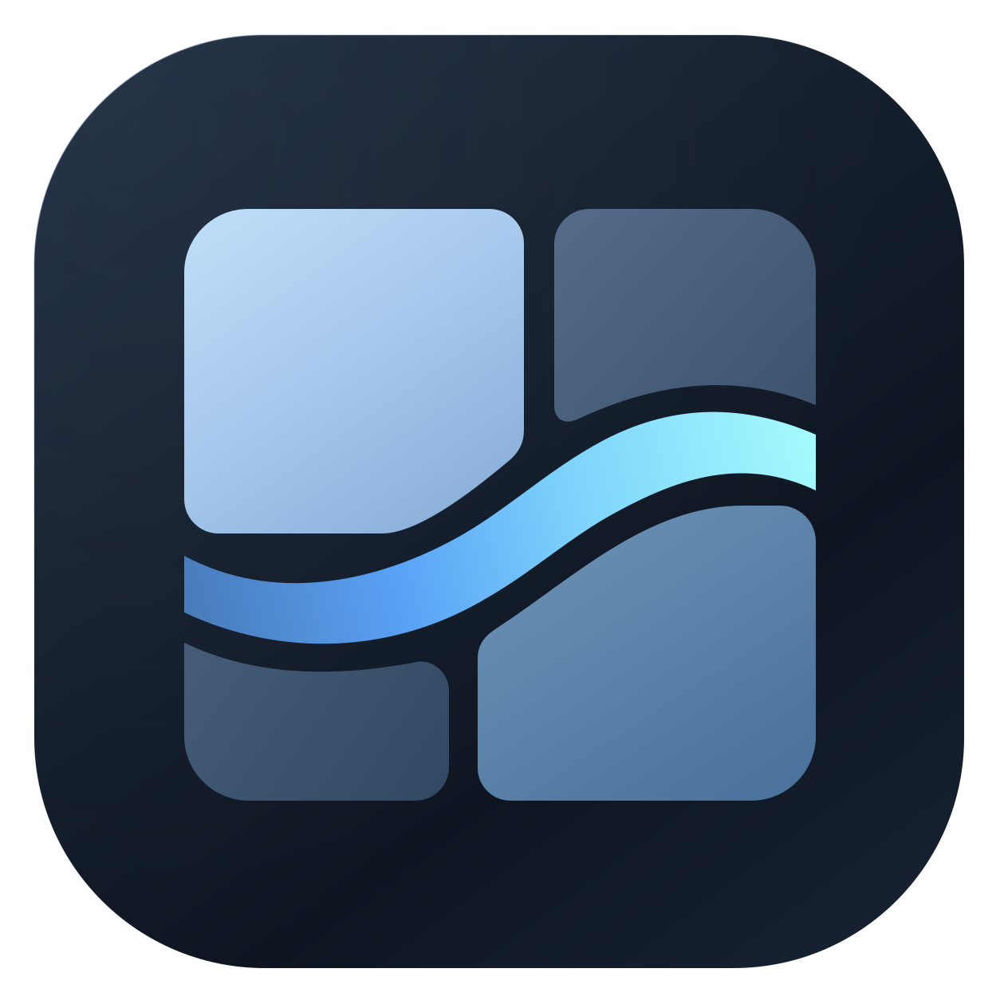
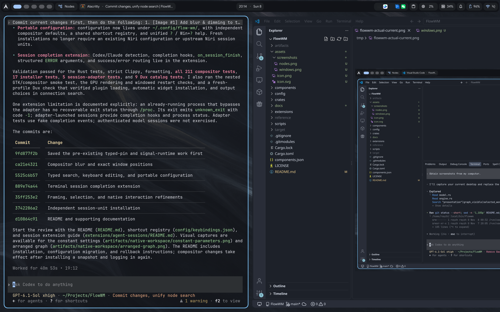
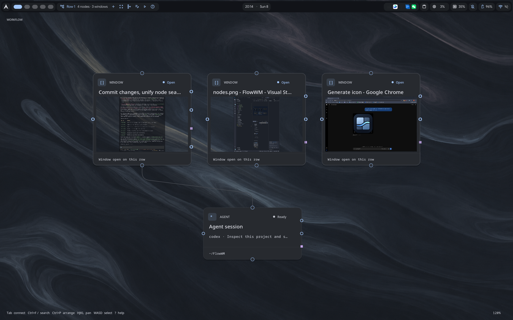

<p align="center">
  
</p>
<h1 align="center">FlowWM</h1>
<p align="center">A Wayland desktop for windows, workflows, and agents.</p>
<p align="center">
  <a href="#getting-started">Getting started</a> ·
  <a href="docs/guide.md">User guide</a> ·
  <a href="docs/development.md">Development</a>
</p>

## About

FlowWM brings your application windows and the work around them into one workspace.
Use the scrolling window layout to work as usual, then press **Win+Tab** to see
those windows alongside commands, agents, notes, and decisions in a node graph.
Connect the steps, run them when you're ready, and review the results where you work.

It combines a fork of [niri](https://github.com/niri-wm/niri), a native GTK graph
editor, and the [Dux desktop shell](https://github.com/duxlabs-dev/dux-shell).
FlowWM is under active development.

## Screenshots

| Windows view | Nodes view |
| --- | --- |
| [](assets/screenshots/windows.png) | [](assets/screenshots/nodes.png) |

A running FlowWM desktop in both views. **Win+Tab** switches between them;
click either screenshot for the full image.

## Features

- **Windows in the graph.** Live application previews sit beside your workflow nodes.
  Open a preview to interact with the window.
- **Workflows you can connect.** Combine shell commands, Python or Vox scripts,
  typed data, agents, and review steps.
- **A graph for each workspace.** Node positions, camera, and selection persist
  as you move between workspace rows.
- **Create and connect from search.** Find nodes, add new ones, and choose
  compatible connections through Dux.
- **Keep work moving.** Save reusable recipes and respond to terminal agent
  completion with the bundled [session extension](extensions/agent-sessions/README.md).

## Getting started

FlowWM currently builds from source on Linux. You need a working Wayland graphics
stack, a systemd user session, and the [build and runtime dependencies](docs/guide.md#install).
From a checkout of this repository:

```sh
python3 scripts/components.py bootstrap
python3 scripts/install.py
```

The installer builds the desktop and creates `~/.local/bin/flowwm` and
`~/.local/bin/flowwm-session`. Add `~/.local/bin` to your `PATH`.
To add FlowWM to your login screen:

```sh
sudo install -Dm644 ~/.config/flow-wm/flowwm.desktop /usr/share/wayland-sessions/flowwm.desktop
```

Log out and choose **FlowWM**, or run `flowwm-session login` from a free TTY.
Configuration lives in `~/.config/flow-wm/`. Agent nodes require your own Codex
installation and authentication.

See the [user guide](docs/guide.md) for configuration, updates, rollback, and CLI usage.

## A few useful keys

**Win** is niri's `Mod` key.

| Shortcut | Action |
| --- | --- |
| Win+Tab | Switch between windows and nodes; return from a window peek first |
| Win+Space | Open Dux app search in Windows; create a node in Nodes |
| Alt+Space | Open Dux app search in either view |
| Win+Shift+Space | Find a node |
| Win+T, Win+K, Win+Return | Open a terminal |
| Win+V / Win+P | Clipboard / power menu |
| Tab | Connect the selected node to another node or a new step |
| Ctrl+P | Arrange and frame the graph |
| R | Run the selected node |
| Win+- / Win+= | Zoom out / in in Nodes |
| Win+? | Show all shortcuts |

Graph shortcuts apply in Nodes view. The [user guide](docs/guide.md#keyboard-and-mouse)
has the full keyboard and mouse reference.

## Development

The [development guide](docs/development.md) covers building, testing, and running
FlowWM in an isolated nested desktop. [Nodes and signals](docs/nodes-and-signals.md)
describes typed connections and extensions.

FlowWM builds on the work of niri and Dux contributors. It is licensed under
[GPL-3.0-or-later](LICENSE); bundled components retain their own licenses.
