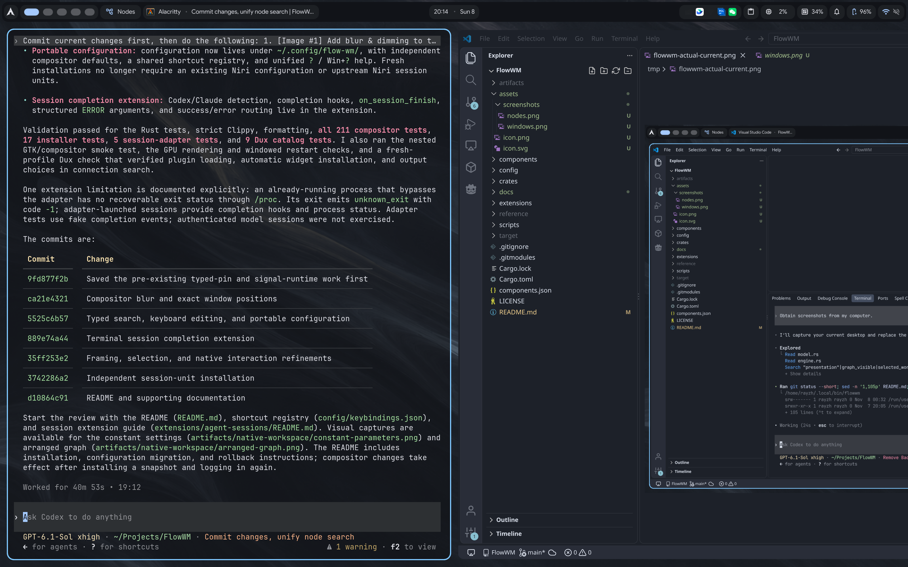
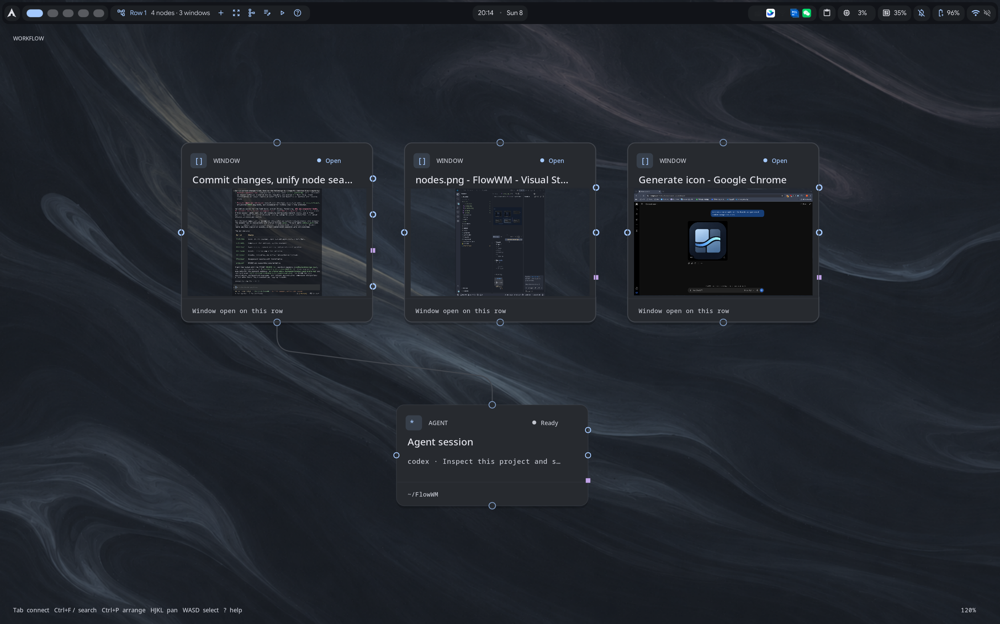
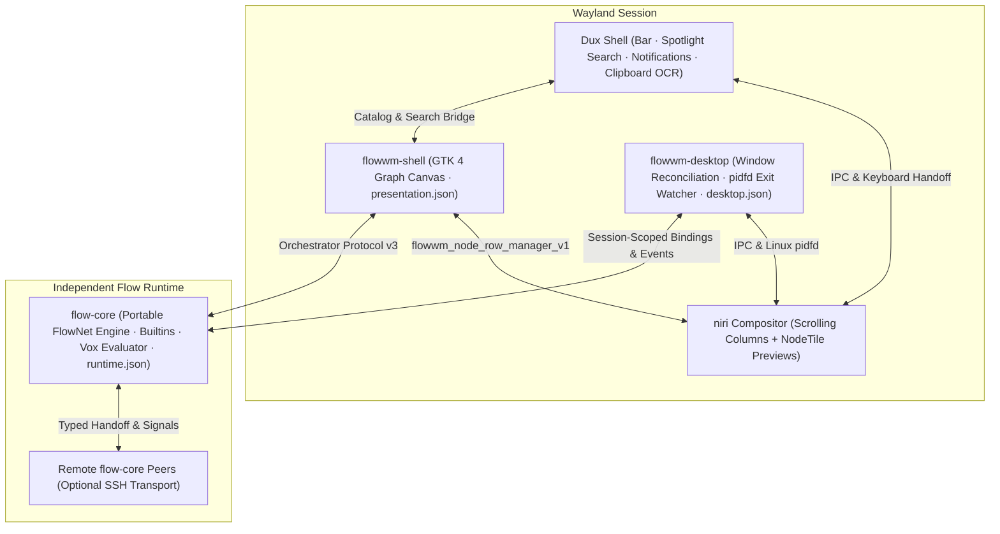

<div align="center">
  
  <h1>FlowWM</h1>
  <p><strong>A Wayland desktop where scrollable window tiling and executable node workflows share one workspace.</strong></p>
  <p>
    <a href="https://github.com/RayZh-hs/flow-wm/actions/workflows/core.yml"></a>
    <a href="#getting-started"></a>
    <a href="docs/development.md"></a>
    <a href="#configuration"></a>
    <a href="LICENSE"></a>
  </p>
  <p>
    <a href="#overview">Overview</a> ·
    <a href="#highlights">Highlights</a> ·
    <a href="#how-it-works">How it works</a> ·
    <a href="#getting-started">Getting started</a> ·
    <a href="#configuration">Configuration</a> ·
    <a href="#shortcuts">Shortcuts</a> ·
    <a href="#documentation">Documentation</a>
  </p>
</div>

<br>

<table>
  <thead>
    <tr>
      <th width="50%" align="center">Windows view</th>
      <th width="50%" align="center">Nodes view</th>
    </tr>
  </thead>
  <tbody>
    <tr>
      <td align="center">
        <a href="assets/screenshots/windows.png">
          
        </a>
      </td>
      <td align="center">
        <a href="assets/screenshots/nodes.png">
          
        </a>
      </td>
    </tr>
    <tr>
      <td align="center">
        <sub>Scrollable tiling columns with the integrated Dux bar and launcher.</sub>
      </td>
      <td align="center">
        <sub>Press <kbd>Win</kbd>+<kbd>Tab</kbd> to morph live windows onto the row's executable node graph.</sub>
      </td>
    </tr>
  </tbody>
</table>

## Overview

Traditional desktops treat application windows as isolated rectangles, leaving the surrounding automation—build scripts, coding agents, environment setup, watchers, and review steps—scattered across terminals and tabs. **FlowWM** brings windows and the workflows around them onto the same persistent canvas.

Work naturally in **Windows view** using smooth scrolling columns, then press <kbd>Win</kbd>+<kbd>Tab</kbd> to enter **Nodes view**, where those exact Wayland windows appear as live, interactive cards alongside shell commands, Vox and Python scripts, AI agent sessions, typed constants, notes, and decisions. Window previews stay inside the compositor—never screenshots or screencasts. Double-click or press <kbd>Enter</kbd> on a window card to **peek** and interact with it in place, connect its exit or agent-completion events to downstream steps, and return to tiling windows at any time.

> [!NOTE]
> FlowWM combines a custom fork of [niri](https://github.com/niri-wm/niri), a native GTK 4 graph canvas, an independent FlowNet runtime, and the [Dux desktop shell](https://github.com/duxlabs-dev/dux-shell). It is under active development—review commands in workflow nodes before running them.

## Highlights

<table>
  <tbody>
    <tr>
      <td width="50%" valign="top">
        <h3>Compositor-native window cards</h3>
        <p>Window buffers are projected directly by the compositor via <code>flowwm_node_row_manager_v1</code> with zero capture overhead. Each workspace row preserves its own graph, camera, selection, working directory, and environment variables. On Linux 6.15+, window cards observe client <code>pidfd</code> exits to emit typed <code>on_exit(exit_code: UInt8)</code> signals.</p>
      </td>
      <td width="50%" valign="top">
        <h3>Typed signals &amp; lazy dataflow</h3>
        <p>Every node separates event control flow from passive computation. Queued <strong>Signals</strong> carry typed argument records along top/bottom pins; <strong>Data</strong> pins evaluate lazily upstream once per event delivery, with diamond caching, static cycle rejection, generic <code>List[T]</code> inference, and extensible type casts.</p>
      </td>
    </tr>
    <tr>
      <td width="50%" valign="top">
        <h3>First-class agent &amp; terminal workflows</h3>
        <p>Run <strong>Codex</strong>, <strong>Claude Code</strong>, or custom CLI harnesses as interactive terminals or supervised pipeline steps with structured handoffs. The bundled <a href="extensions/agent-sessions/README.md">agent-sessions</a> extension attaches <code>on_session_finish</code> and <code>is_idle</code> outputs to ordinary terminals without modifying your CLI config files.</p>
      </td>
      <td width="50%" valign="top">
        <h3>Inline Vox, Python &amp; Shell</h3>
        <p>Write <strong>Vox</strong> expressions rendered with live syntax highlighting directly on the card, backed by autocompletion, automatic port/type inference from <code>inputs.*</code> and returned records, and port-to-code hover highlighting—or execute Python scripts and supervised Shell process groups.</p>
      </td>
    </tr>
    <tr>
      <td width="50%" valign="top">
        <h3>Zero-latency Dux search &amp; wiring</h3>
        <p>Start typing immediately after pressing <kbd>Win</kbd>+<kbd>Space</kbd>—the compositor holds keystrokes until Dux Spotlight is ready. Launch apps, jump across named rows and windows (<code>#</code>), invoke layout macros (<code>@ &gt;</code>), instantiate saved recipes (<code>@ #</code>), or press <kbd>Tab</kbd> on a node to wire compatible pins from the keyboard.</p>
      </td>
      <td width="50%" valign="top">
        <h3>Crash-safe, self-contained desktop</h3>
        <p>The headless runtime (<code>flow-core</code>), compositor observer (<code>flowwm-desktop</code>), and GTK 4 UI (<code>flowwm-shell</code>) run as independent processes. Reloading the UI or live-replacing an installed snapshot (<code>--replace</code>) keeps windows and active jobs running, while leaving any existing <code>~/.config/niri</code> setup untouched.</p>
      </td>
    </tr>
  </tbody>
</table>

## How it works

### Node anatomy

Nodes connect through typed **Signal** and **Data** pins. Signal wires route execution and event payloads from top to bottom; data wires supply typed inputs from left to right when a recipient runs.

| Position | Pin &amp; wire | Kind | Behavior |
| :--- | :--- | :--- | :--- |
| **Top** | `●` Round · Solid | `Signal[Args]` input | Queues an incoming trigger or typed event record for execution |
| **Bottom** | `●` Round · Solid | `Signal[Args]` output | Emits completion, branch (`true` / `false`), `on_exit`, or `on_session_finish` |
| **Left** | `■` Square · Dashed | Typed data input | Evaluated lazily upstream before execution; shared across diamond fanout |
| **Right** | `■` Square · Dashed | Typed data output | Exposes computed values (`Int`, `Float`, `Bool`, `String`, `List[T]`, `Record`, `Env`) |

### Built-in node palette

| Category | Nodes |
| :--- | :--- |
| **Windows &amp; sessions** | `Window` (live Wayland surface + `on_exit`), `Agent session` (interactive CLI or supervised workflow), **Power off**, **Restart computer**, **Sleep**, **Hibernate**, **Log out**, **Lock session** |
| **Code &amp; commands** | `Vox` (inline typed expressions), `Python` (scripted data &amp; events), `Shell` (supervised process groups with `FLOWWM_DATA_INPUTS` and directory serialization) |
| **Data, lists &amp; env** | `Constant` (inline-editable `Int`, `Float`, `String`, `Bool`, `List`, `Record`), `Display`, typed `List[T]` templates (`Make`, `Append`, `Concatenate`, `Slice`, `Contains`, …), `Set Env`, `Unset Env`, `Empty Env`, `Bake Args into Env` |
| **Routing &amp; barriers** | `Conditional`, `Break signal`, `Merge signal`, `Join` (correlated multi-branch barrier with terminal `failed` path), `On all fired`, `On all true`, `Handle session error` |
| **Sources, human &amp; alerts** | `Metric` / `Timer` / `Watcher`, `Broadcast` / `Receive` (cross-workflow signals), `Decision` (approve / reject gate), `You` (canvas notes &amp; tasks), `Alert` (desktop notifications + <kbd>Win</kbd>+<kbd>A</kbd> urgency outline) |

### Architecture

FlowWM separates portable dataflow execution from Wayland composition and desktop UI:



`crates/flow-core` has zero Wayland, GTK, or Unix-process dependencies and is continuously tested across Linux, macOS, and Windows. Extensions can mount declarative schemas, subprocess providers, custom settings forms, and cached GLSL ES 3.00 node surfaces via `~/.config/flow-wm/extensions/`.

## Getting started

FlowWM builds from source on Linux and installs into self-contained, versioned snapshots. It requires a working Wayland graphics stack and an active `systemd` user login session (Linux 6.15+ is recommended for automatic `pidfd` window exit codes).

### 1. Install

From your regular user account (do **not** run `bash` under `sudo`), run the bootstrap installer:

```sh
curl -fsSL https://raw.githubusercontent.com/RayZh-hs/flow-wm/main/install.sh | bash
```

The script installs native build and desktop dependencies via `pacman`, `apt-get`, or `dnf`, prepares a current Rust toolchain with `rustup` when needed, checks out FlowWM into `${XDG_CACHE_HOME:-~/.cache}/flowwm/source`, and builds an installed snapshot with launchers at `~/.local/bin/flowwm` and `~/.local/bin/flowwm-session`.

> [!IMPORTANT]
> Only system package installation uses `sudo`, keeping your package manager's confirmation prompts. On **Arch Linux**, dependency installation runs `pacman -Syu`, which includes a full system upgrade. Ensure `~/.local/bin` is in your `PATH`.

<details>
<summary><strong>Installer options &amp; distribution notes (Arch <code>gtk4-layer-shell</code>, manual checkouts)</strong></summary>

Inspect the bootstrap script or pass flags directly:

```sh
curl -fL https://raw.githubusercontent.com/RayZh-hs/flow-wm/main/install.sh -o flowwm-install.sh
bash flowwm-install.sh --help
bash flowwm-install.sh --skip-deps --source-dir "$HOME/src/flow-wm" --ref main
```

- `--skip-deps` — Verify required libraries and tools without installing system packages or Rust (use this on distributions without `pacman`, `apt-get`, or `dnf` after installing the [documented dependencies](docs/guide.md#install)).
- `--yes` — Automatically confirm package manager transactions (`sudo` may still prompt for your password).
- `--source-dir PATH` / `--ref REF` — Customize the checkout path or Git branch/tag/commit.

**GTK4 Layer Shell package names:** `gtk4-layer-shell-0` is the `pkg-config` module name—not an AUR package. Install your distribution's official package:

| Distribution | Package |
| :--- | :--- |
| Arch Linux | `gtk4-layer-shell` (official **Extra** repository) |
| Debian / Ubuntu | `libgtk4-layer-shell-dev` |
| Fedora | `gtk4-layer-shell-devel` |

```sh
# Verify on Arch Linux:
sudo pacman -Syu --needed gtk4-layer-shell
pkg-config --modversion gtk4-layer-shell-0
```

**Build from an existing repository checkout:**

```sh
python3 scripts/components.py bootstrap
python3 scripts/install.py
```

</details>

### 2. Start a session

Register FlowWM with your system display manager:

```sh
sudo install -Dm644 ~/.config/flow-wm/flowwm.desktop /usr/share/wayland-sessions/flowwm.desktop
```

Log out and choose **FlowWM** on your login screen (any existing **Niri** session entry stays separate), or launch directly from a free TTY:

```sh
~/.local/bin/flowwm-session login
```

Agent nodes use your own local **Codex** or **Claude Code** installation and authentication.

### 3. Update & rollback

Snapshots live under `~/.local/share/flowwm/installed/` and preserve your `~/.config/flow-wm/` profile across updates:

```sh
python3 scripts/install.py                       # Build and stage a snapshot for next login
python3 scripts/install.py --replace             # Install and live-reload UI, Dux, and desktop services now
python3 scripts/install.py --rollback            # Select the previous snapshot for next login
python3 scripts/install.py --rollback --replace  # Roll back and reload services immediately
flowwm-session describe                          # Inspect active snapshot paths and binary checksums
```

## Configuration

All operational logic—compositor layout, window rules, key bindings, canvas motion, agent harnesses, runtime concurrency, and session commands—is configured in **`~/.config/flow-wm/`** (or `$XDG_CONFIG_HOME/flow-wm/`) using clean, [niri](https://github.com/niri-wm/niri)-style KDL files:

```text
~/.config/flow-wm/
├── config.kdl      # Compositor layout, rules, global & node-scoped shortcuts, and flow canvas settings
├── runtime.kdl     # Concurrency, timeouts, terminal pwd adapters, and remote SSH peers
├── agent.kdl       # Default agent harness (codex, claude, or custom argv wrappers) and terminal
├── session.kdl     # Literal argv vectors for power, reboot, sleep, hibernate, logout, and lock nodes
├── extensions/     # Declarative v3 JSON manifests for custom types, casts, nodes, and GLSL shaders
└── dms/            # Self-contained Dux shell settings, plugins, and generated theme includes
```

`config.kdl` unifies standard niri compositor rules with `scope="nodes"` bindings and the `flow { ... }` graph configuration block:

```kdl
binds {
    Mod+Tab   repeat=false allow-inhibiting=false { spawn "flowwm" "toggle"; }
    Mod+Space repeat=false allow-inhibiting=false {
        spawn-with-keyboard-focus "flowwm" "new" namespace="dms:spotlight" wait-for-ready=true;
    }
    Ctrl+Shift+P scope="nodes" repeat=false allow-inhibiting=false {
        spawn-with-keyboard-focus "flowwm" "search" "macros" namespace="dms:spotlight" wait-for-ready=true;
    }
}

flow {
    terminal "alacritty"
    motion-ms 220
    arrange-wrap-zoom 0.4
    arrange-gap 48.0
    code-auto-complete true
    pin-usage-highlight true
    running-color "#71c68c"
    alert-color "#ff9e64"

    binds {
        Tab          action="connect"    title="Choose an output, then a compatible node"
        Ctrl+p       action="arrange"    title="Arrange and frame the graph"
        Ctrl+Shift+v action="create_vox" title="Create a Vox code node"
        Ctrl+g       action="group"      title="Group selected nodes"
        Ctrl+t       action="text"       title="Add a resizable text field"
        r            action="run"        title="Run selected node"
    }
}
```

Niri validates and hot-reloads compositor settings and global `binds` when `config.kdl` is saved; set `action="none"` inside `flow { binds { ... } }` to disable any default graph key.

## Shortcuts

**Win** (`Super`) is niri's `Mod` key. Press <kbd>Win</kbd>+<kbd>?</kbd> in either view (or <kbd>?</kbd> on the canvas) to open the searchable **Key Bindings** overlay read directly from `config.kdl`.

### Desktop, views & workspace rows

| Shortcut | Action |
| :--- | :--- |
| <kbd>Win</kbd>+<kbd>Tab</kbd> | Switch between Windows and Nodes views (exits a window peek first) |
| <kbd>Win</kbd>+<kbd>Space</kbd> | Open Dux app search in Windows view; create a node in Nodes view |
| <kbd>Alt</kbd>+<kbd>Space</kbd> | Open Dux app search from either view |
| <kbd>Win</kbd>+<kbd>Shift</kbd>+<kbd>Space</kbd> | Find a workflow node across workspaces |
| <kbd>Win</kbd>+<kbd>L</kbd> | Edit row name, owning workspace, working directory (`pwd`), and row variables |
| <kbd>Win</kbd>+<kbd>H</kbd> | Collapse or expand the current workflow row |
| <kbd>Win</kbd>+<kbd>A</kbd> | Focus the next alerted window or node across workspaces |
| <kbd>Win</kbd>+<kbd>M</kbd> | Dismiss all visible notification popups |
| <kbd>Win</kbd>+<kbd>T</kbd> / <kbd>Win</kbd>+<kbd>K</kbd> | Open a terminal inheriting the current row's environment and `pwd` |
| <kbd>Win</kbd>+<kbd>V</kbd> / <kbd>Win</kbd>+<kbd>P</kbd> | Open clipboard history / power menu |
| <kbd>Win</kbd>+<kbd>I</kbd> / <kbd>Win</kbd>+<kbd>U</kbd> | Switch workspace row up / down (also <kbd>Win</kbd>+<kbd>PgUp</kbd> / <kbd>PgDn</kbd>) |
| <kbd>Win</kbd>+<kbd>?</kbd> | Show all configured shortcuts |

### Nodes canvas & workflow editing

| Shortcut | Action |
| :--- | :--- |
| <kbd>Tab</kbd> | Connect the selected node's output to a compatible existing or new node |
| <kbd>Enter</kbd> | Peek into a live window card, edit a constant inline, or inspect output |
| <kbd>Win</kbd>+<kbd>Enter</kbd> / <kbd>Win</kbd>+<kbd>Q</kbd> | Edit Vox or run selected nodes / stop selection (opens terminal / closes window in Windows view) |
| <kbd>R</kbd> / <kbd>E</kbd> | Run selected node / open node parameters |
| <kbd>Ctrl</kbd>+<kbd>Shift</kbd>+<kbd>V</kbd> | Create a Vox code node |
| <kbd>Ctrl</kbd>+<kbd>T</kbd> | Add a resizable canvas text field |
| <kbd>Ctrl</kbd>+<kbd>G</kbd> / <kbd>Ctrl</kbd>+<kbd>Shift</kbd>+<kbd>G</kbd> | Group / ungroup selected nodes into a named frame |
| <kbd>Ctrl</kbd>+<kbd>P</kbd> | Compact, align, and frame the entire graph |
| <kbd>Ctrl</kbd>+<kbd>Shift</kbd>+<kbd>P</kbd> | Open workflow macros (`@ >`) in Nodes view |
| <kbd>Ctrl</kbd>+<kbd>Z</kbd> / <kbd>Ctrl</kbd>+<kbd>Shift</kbd>+<kbd>Z</kbd> | Undo / redo graph edits |
| <kbd>H</kbd> <kbd>J</kbd> <kbd>K</kbd> <kbd>L</kbd> / <kbd>W</kbd> <kbd>A</kbd> <kbd>S</kbd> <kbd>D</kbd> | Smoothly pan the viewport / move selection between cards (add <kbd>Shift</kbd> for fast pan or grid nudge) |
| <kbd>Alt</kbd>+<kbd>1</kbd>…<kbd>0</kbd> / <kbd>Space</kbd>+<kbd>1</kbd>…<kbd>0</kbd> | Select node by index badge / toggle connection with indexed node |
| <kbd>Win</kbd>+<kbd>-</kbd> / <kbd>Win</kbd>+<kbd>=</kbd> | Zoom out / in around the viewport center |

### Dux search prefixes

| Query | Results |
| :--- | :--- |
| `@` | Workflow macros and **Create a node** |
| `@ <name>` | Search workflow nodes across all workspace rows |
| `@ + <type>` | Node types, typed constants, and registered macros |
| `@ > <name>` | Canvas actions: Rearrange, Frame all nodes, Undo, Redo |
| `# <name>` | Workspace rows (with one-step **Expand** for collapsed rows) and open windows |
| `@ # <name>` | Saved reusable workflow recipes |

See the [User guide](docs/guide.md#keyboard-and-mouse) for the complete keyboard, mouse, and trackpad gesture reference, and [Canvas editing](docs/canvas-editing.md) for Vox completion, port inference, groups, and context menus.

## CLI & development

Inspect and drive graphs from scripts or terminals over FlowWM's user-scoped Unix sockets, or build integrations with the [Python SDK](sdk/python/README.md):

```sh
flowwm status                              # Inspect the native host runtime snapshot
flowwm nodes                               # List nodes on the active workflow
flowwm add shell --command 'cargo test'    # Add a shell node to the current row
flowwm run <node-id> --downstream          # Execute a node and trigger downstream steps
flowwm focus-alert                         # Jump to the next alerted window or node
flowwm row-settings                        # Open the current row's environment settings
```

To build, test, and run FlowWM inside an **isolated nested Wayland window** without touching an installed session:

```sh
python3 scripts/components.py bootstrap
python3 scripts/dev.py build flowwm
python3 scripts/dev.py build niri
python3 scripts/dev.py test
python3 scripts/dev.py nested
```

## Documentation

| Guide | Contents |
| :--- | :--- |
| **[User guide](docs/guide.md)** | Full installation details, desktop navigation, Dux search, row environments, KDL reference, and CLI |
| **[Canvas editing](docs/canvas-editing.md)** | Inline Vox syntax, autocomplete, port/type inference, node groups, text fields, and context menus |
| **[Nodes & signals](docs/nodes-and-signals.md)** | Data vs. signal evaluation, types and casts, row environments, `on_exit` observation, and desktop alerts |
| **[Workflow utilities](docs/workflow-utilities.md)** | Session power/lock actions, generic `List[T]` templates, `On all true`, `On all fired`, and agent `is_idle` |
| **[Agent sessions](docs/agent-sessions.md)** | Interactive and supervised Codex/Claude sessions, `agent.kdl` harnesses, and structured handoffs |
| **[Terminal session extension](extensions/agent-sessions/README.md)** | Automatic `on_session_finish` hooks, process-tree observation, and error routing for terminal CLIs |
| **[Runtime & protocols](docs/runtime.md)** | Crate boundaries, atomic persistence, crash recovery, Orchestrator Protocol v3, and SSH peers |
| **[Extensions & shaders](docs/design/extensions.md)** | Subprocess providers, native settings forms, and custom GLSL ES 3.00 node surfaces ([example](examples/extension-shader.json)) |
| **[Python SDK](sdk/python/README.md)** | Client library for Orchestrator Protocol v3, Signal Protocol v1, and application hooks |
| **[Development guide](docs/development.md)** | Repository layout, subtree management (`niri` & `dms`), Xvfb/Wayland smoke suites, and [view profiling](docs/node-view-performance.md) |
| **[Upgrading](docs/upgrading.md)** | One-time conversion and staged service cutover from pre-v3 embedded state |

## Acknowledgments & license

FlowWM builds upon the work of the [niri](https://github.com/niri-wm/niri) and [Dux (DankMaterialShell)](https://github.com/duxlabs-dev/dux-shell) communities; upstream and fork revisions are tracked in [`components.json`](components.json).

FlowWM is licensed under **[GPL-3.0-or-later](LICENSE)**. Bundled components retain their respective upstream licenses and attributions.
